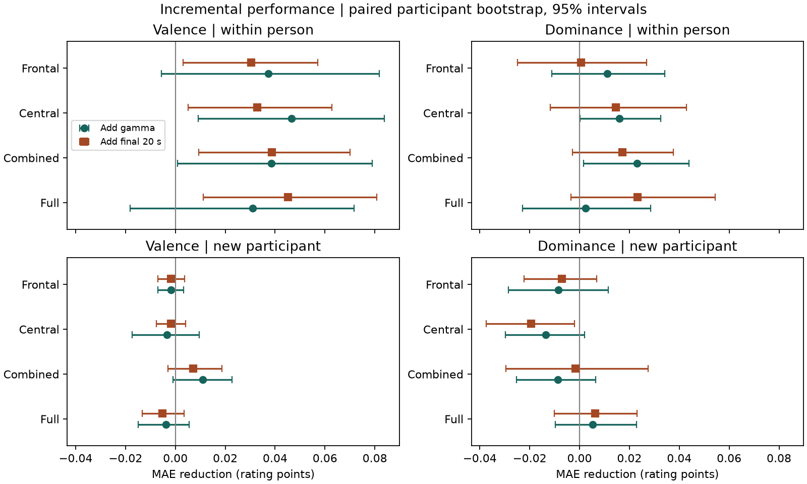

# 감마와 영상 후반부의 예측 기여

32명 × 영상 40편의 Valence·Dominance를 독립적으로 예측했다. 기존 EEG 특징과 Ridge 설정으로 각각의 입력 조건을 처음부터 재학습했다. 감마는 30 이상 45 Hz 미만이다. 절대 파워와 기준선 대비 변화량 열을 함께 포함하거나 제거했다. 전체 시간 모델에는 세 구간의 특징이 각각 들어간다. 후반의 추가 기여를 직접 측정하기 위해 0–40초 모델도 계산했다.

Frontal은 F3/F4, Central은 C3/C4, Combined는 이 네 채널, Full은 전체 32채널이다. 개인 내 평가는 참가자별 영상 외부 5분할, 새 참가자는 참가자 단위 외부 4분할이다. 내부 3분할에서 표준화·F 점수 선택·Ridge α(10, 100) 튜닝을 수행했다. 특징 선택 수는 min(16, 입력 특징 수)다. 각 모델의 외부 학습 폴드 전체에 선택된 설정을 재적합했다. 모든 조건의 평가 시행·폴드를 대조하고, 전체 구간·감마 포함 모델의 20,480개 보류 예측을 이전 실험과 1e-10 허용오차로 검증했다.

개선량은 기준 모델 MAE에서 비교 모델 MAE를 뺀 값이다. R² 개선량은 비교 모델 R²에서 기준 모델 R²를 뺀 값이다. 참가자를 짝지어 10,000회 복원추출(시드 42)하고 95% 백분위 구간을 계산했다. R² 차이는 매 표본의 전체 보류 시행에서 다시 계산했다. 구간은 이 영상과 고정된 교차검증 예측에 대한 기술적 구간이다. 새 영상 표집·모델 재훈련 변동과 다중 비교를 반영하지 않는다. 선행 분석에서 같은 데이터의 가중치를 보고 세운 가설이므로 독립 표본 재현이 필요한 탐색 결과다.

### 기존 계수 비중과 보류 예측 성능

개인 내 32채널 Valence에서는 감마 추가 시 MAE가 0.031점 감소했지만 대응 구간은 0을 포함했다. 같은 조건에서 처음 40초에 마지막 20초를 추가하면 MAE가 0.045점 감소했고 구간은 0.011~0.081점이었다. 32채널 Dominance에서 전체 구간 감마 추가 이득은 0.002점으로 작았다. 후반 단독은 전체보다 MAE가 0.030점 낮았지만 이 차이의 구간도 0을 포함했다.

개인 내 Valence에서 후반 추가 이득의 구간은 네 전극 구성 모두 양수였다. 새 참가자에서는 어느 구성에서도 같은 이득을 확인하기 어려웠고, Central 단독 Dominance에서는 후반 추가 후 오히려 0.019점 악화됐다. 계수가 집중된 대역·구간의 비중만으로 개인 밖의 예측 이득을 판단하기 어렵다.

## 개인 내 미관측 영상

각 칸은 MAE / R² / 학습 중앙값보다 개인 MAE가 작은 인원(32명 중)이다.

|라벨|채널|감마|전체|0–20초|20–40초|40–60초|0–40초|
|---|---|---|---:|---:|---:|---:|---:|
|Dominance|Central|포함|1.525 / 0.156 / 17|1.545 / 0.141 / 19|1.556 / 0.129 / 18|1.520 / 0.169 / 20|1.540 / 0.149 / 18|
|Dominance|Central|제외|1.541 / 0.144 / 17|1.539 / 0.142 / 18|1.565 / 0.124 / 17|1.539 / 0.156 / 16|1.552 / 0.132 / 17|
|Dominance|Combined|포함|1.508 / 0.161 / 19|1.514 / 0.170 / 20|1.534 / 0.145 / 19|1.520 / 0.167 / 18|1.525 / 0.150 / 17|
|Dominance|Combined|제외|1.530 / 0.149 / 18|1.525 / 0.147 / 19|1.561 / 0.116 / 12|1.529 / 0.158 / 18|1.542 / 0.128 / 17|
|Dominance|Frontal|포함|1.523 / 0.155 / 19|1.529 / 0.148 / 18|1.544 / 0.136 / 16|1.540 / 0.137 / 17|1.523 / 0.157 / 21|
|Dominance|Frontal|제외|1.534 / 0.148 / 16|1.536 / 0.142 / 15|1.546 / 0.137 / 16|1.551 / 0.142 / 17|1.539 / 0.141 / 18|
|Dominance|Full|포함|1.517 / 0.148 / 17|1.532 / 0.127 / 15|1.544 / 0.115 / 19|1.487 / 0.183 / 20|1.541 / 0.129 / 16|
|Dominance|Full|제외|1.520 / 0.152 / 17|1.533 / 0.137 / 14|1.555 / 0.093 / 18|1.515 / 0.163 / 15|1.546 / 0.117 / 15|
|Valence|Central|포함|1.682 / 0.063 / 21|1.703 / 0.048 / 21|1.753 / -0.012 / 18|1.696 / 0.058 / 24|1.715 / 0.042 / 21|
|Valence|Central|제외|1.728 / 0.025 / 16|1.734 / 0.018 / 16|1.767 / -0.008 / 19|1.752 / 0.005 / 18|1.720 / 0.025 / 19|
|Valence|Combined|포함|1.691 / 0.038 / 22|1.720 / 0.017 / 19|1.727 / 0.020 / 21|1.705 / 0.037 / 20|1.730 / -0.004 / 17|
|Valence|Combined|제외|1.730 / 0.014 / 18|1.743 / 0.006 / 18|1.778 / -0.018 / 16|1.739 / -0.004 / 19|1.757 / -0.011 / 16|
|Valence|Frontal|포함|1.727 / 0.000 / 19|1.764 / -0.037 / 20|1.777 / -0.036 / 19|1.738 / 0.017 / 21|1.758 / -0.029 / 20|
|Valence|Frontal|제외|1.764 / -0.021 / 18|1.772 / -0.011 / 19|1.796 / -0.027 / 16|1.786 / -0.021 / 16|1.784 / -0.036 / 17|
|Valence|Full|포함|1.635 / 0.075 / 26|1.748 / -0.053 / 16|1.677 / 0.038 / 22|1.642 / 0.084 / 24|1.680 / 0.018 / 21|
|Valence|Full|제외|1.666 / 0.060 / 22|1.745 / -0.000 / 17|1.713 / 0.021 / 21|1.678 / 0.061 / 24|1.714 / 0.026 / 23|

아래는 전체 구간에서 감마를 추가한 효과와 감마 포함 상태에서 마지막 20초를 추가한 효과다. 각 칸은 MAE 개선량 [95% 구간] 및 개선 인원이다.

|라벨|채널|감마 추가|후반 추가|
|---|---|---:|---:|
|Dominance|Central|+0.016 [+0.000, +0.033] · 19/32|+0.015 [-0.012, +0.043] · 13/32|
|Dominance|Combined|+0.023 [+0.002, +0.044] · 19/32|+0.017 [-0.003, +0.038] · 16/32|
|Dominance|Frontal|+0.011 [-0.011, +0.034] · 16/32|+0.001 [-0.025, +0.027] · 14/32|
|Dominance|Full|+0.002 [-0.023, +0.028] · 11/32|+0.023 [-0.004, +0.054] · 13/32|
|Valence|Central|+0.047 [+0.009, +0.084] · 19/32|+0.033 [+0.005, +0.063] · 20/32|
|Valence|Combined|+0.039 [+0.001, +0.079] · 19/32|+0.039 [+0.009, +0.070] · 19/32|
|Valence|Frontal|+0.037 [-0.006, +0.082] · 18/32|+0.030 [+0.003, +0.057] · 21/32|
|Valence|Full|+0.031 [-0.018, +0.072] · 20/32|+0.045 [+0.011, +0.081] · 18/32|

## 미관측 참가자

각 칸은 MAE / R² / 학습 중앙값보다 개인 MAE가 작은 인원(32명 중)이다.

|라벨|채널|감마|전체|0–20초|20–40초|40–60초|0–40초|
|---|---|---|---:|---:|---:|---:|---:|
|Dominance|Central|포함|1.750 / -0.009 / 16|1.734 / 0.003 / 15|1.714 / 0.023 / 15|1.718 / 0.022 / 14|1.730 / 0.007 / 14|
|Dominance|Central|제외|1.736 / -0.002 / 14|1.721 / 0.014 / 16|1.714 / 0.019 / 16|1.715 / 0.020 / 16|1.724 / 0.008 / 14|
|Dominance|Combined|포함|1.744 / -0.001 / 15|1.737 / 0.007 / 15|1.729 / 0.012 / 15|1.734 / 0.012 / 15|1.742 / 0.001 / 16|
|Dominance|Combined|제외|1.735 / 0.006 / 16|1.730 / 0.004 / 14|1.732 / 0.001 / 15|1.716 / 0.020 / 16|1.731 / 0.005 / 15|
|Dominance|Frontal|포함|1.751 / -0.016 / 16|1.752 / -0.024 / 13|1.747 / -0.025 / 15|1.741 / -0.013 / 15|1.744 / -0.010 / 13|
|Dominance|Frontal|제외|1.743 / -0.013 / 18|1.742 / -0.020 / 16|1.750 / -0.042 / 17|1.736 / -0.017 / 18|1.741 / -0.023 / 14|
|Dominance|Full|포함|1.763 / -0.055 / 14|1.795 / -0.089 / 13|1.778 / -0.073 / 14|1.768 / -0.066 / 16|1.769 / -0.058 / 15|
|Dominance|Full|제외|1.768 / -0.051 / 16|1.797 / -0.087 / 15|1.796 / -0.085 / 14|1.790 / -0.077 / 15|1.775 / -0.060 / 15|
|Valence|Central|포함|1.816 / -0.026 / 13|1.809 / -0.024 / 13|1.820 / -0.032 / 9|1.817 / -0.027 / 10|1.814 / -0.026 / 13|
|Valence|Central|제외|1.813 / -0.024 / 11|1.813 / -0.026 / 11|1.821 / -0.032 / 8|1.819 / -0.028 / 8|1.819 / -0.031 / 11|
|Valence|Combined|포함|1.818 / -0.026 / 10|1.824 / -0.034 / 10|1.832 / -0.044 / 9|1.834 / -0.041 / 5|1.825 / -0.034 / 10|
|Valence|Combined|제외|1.829 / -0.037 / 7|1.827 / -0.036 / 6|1.836 / -0.049 / 6|1.826 / -0.037 / 6|1.829 / -0.037 / 7|
|Valence|Frontal|포함|1.818 / -0.023 / 9|1.816 / -0.024 / 9|1.817 / -0.023 / 11|1.820 / -0.023 / 8|1.816 / -0.024 / 9|
|Valence|Frontal|제외|1.816 / -0.024 / 11|1.814 / -0.020 / 8|1.814 / -0.020 / 11|1.817 / -0.020 / 8|1.815 / -0.020 / 11|
|Valence|Full|포함|1.821 / -0.033 / 10|1.816 / -0.031 / 13|1.824 / -0.031 / 9|1.827 / -0.030 / 8|1.816 / -0.027 / 10|
|Valence|Full|제외|1.818 / -0.023 / 8|1.814 / -0.030 / 13|1.817 / -0.021 / 9|1.818 / -0.020 / 8|1.811 / -0.015 / 8|

아래는 전체 구간에서 감마를 추가한 효과와 감마 포함 상태에서 마지막 20초를 추가한 효과다. 각 칸은 MAE 개선량 [95% 구간] 및 개선 인원이다.

|라벨|채널|감마 추가|후반 추가|
|---|---|---:|---:|
|Dominance|Central|-0.014 [-0.030, +0.002] · 14/32|-0.019 [-0.037, -0.002] · 9/32|
|Dominance|Combined|-0.009 [-0.025, +0.006] · 11/32|-0.002 [-0.030, +0.028] · 12/32|
|Dominance|Frontal|-0.008 [-0.029, +0.011] · 12/32|-0.007 [-0.022, +0.007] · 15/32|
|Dominance|Full|+0.005 [-0.010, +0.023] · 13/32|+0.006 [-0.010, +0.023] · 16/32|
|Valence|Central|-0.003 [-0.017, +0.010] · 17/32|-0.002 [-0.008, +0.004] · 16/32|
|Valence|Combined|+0.011 [-0.001, +0.023] · 21/32|+0.007 [-0.003, +0.019] · 16/32|
|Valence|Frontal|-0.002 [-0.007, +0.003] · 13/32|-0.002 [-0.007, +0.004] · 11/32|
|Valence|Full|-0.004 [-0.015, +0.006] · 15/32|-0.005 [-0.013, +0.003] · 11/32|

## 근전도와 해석 범위

전처리 MATLAB 파일의 큰광대근·승모근 EMG(1부터 센 채널 35·36)에서도 EEG와 같은 2초 Welch 창으로 구간별 30–45 Hz 절대 파워를 계산했다. 각 사람의 40개 영상 안에서 전극 구성별 평균 EEG 감마 dB와 근육별 EMG 감마 dB 사이의 Spearman 상관을 계산했다. EMG와 이 결과는 모델의 입력이나 특징 선택에 쓰이지 않았다. [DEAP의 센서 배치](https://www.sanderkoelstra.nl/media/documents/Thesis_final_RAL_Koelstra.pdf) · [DEAP 채널 번호](https://openreview.net/pdf/8a045a606abf89ad24e81dea7ff199c2cb5fe88a.pdf)

- 32채널 후반 trapezius 상관 중앙값 +0.020, 개인별 사분위 범위 [-0.114, +0.132], 양의 상관 16/32명.
- 32채널 후반 zygomaticus 상관 중앙값 +0.452, 개인별 사분위 범위 [+0.280, +0.662], 양의 상관 29/32명.

EEG와 EMG가 같은 자극에 함께 반응하거나 근육 전위가 두피 전극에 섞일 수 있다. 두 근육의 상관만으로는 개별 감마 특징의 신경·근육 성분 비율이나 성능 향상의 원인을 식별할 수 없다. 감마 제거는 예측기가 이용할 수 있는 정보와 선택 후보 수를 함께 바꾼다. 두피 고주파 EEG의 근육 혼입은 근신경 차단 실험에서도 관찰됐다. [Whitham 등 원 연구](https://pubmed.ncbi.nlm.nih.gov/17574912/)

## 파일과 재실행

BrainFicial 폴더에서 기존 분석 환경의 Python으로 ablation/run.py, ablation/check_emg.py, ablation/summarize.py를 차례로 실행한다. metrics.csv와 participant_metrics.csv는 모델별·개인별 성능, paired_contrasts.csv는 모든 감마·구간 비교의 개선·악화 인원과 MAE·R² 차이 및 구간, participant_differences.csv는 개인별 대응 차이다. predictions.csv.gz에는 시행별 보류 예측과 선택 α가 있다.
