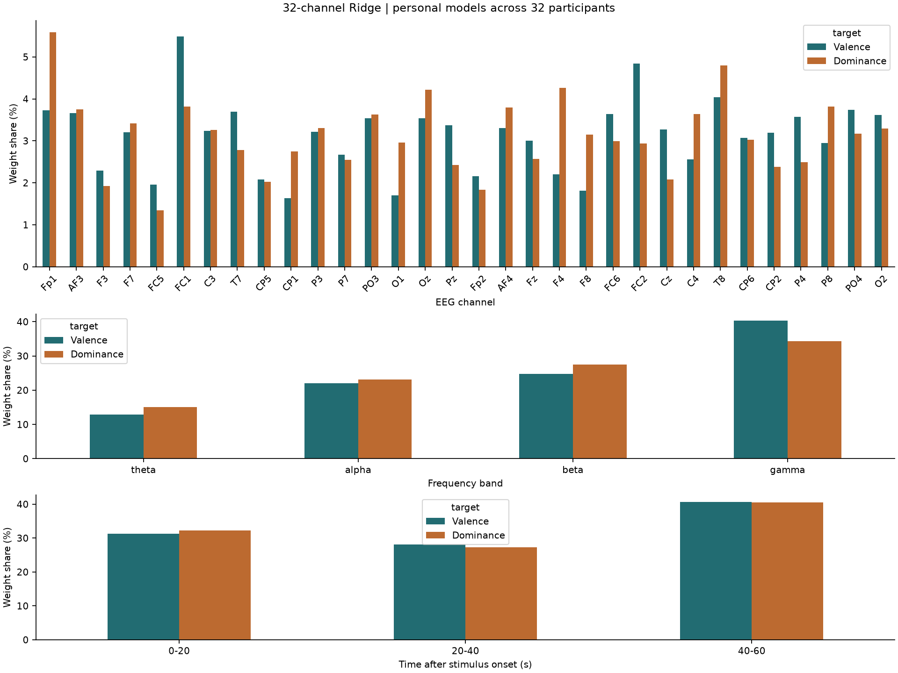
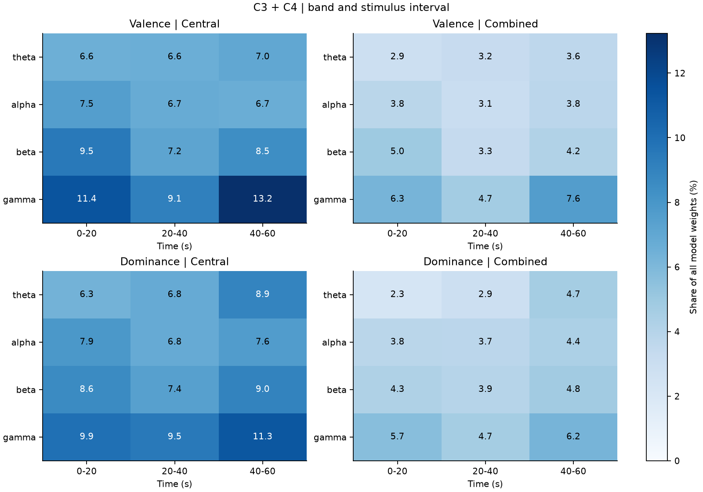
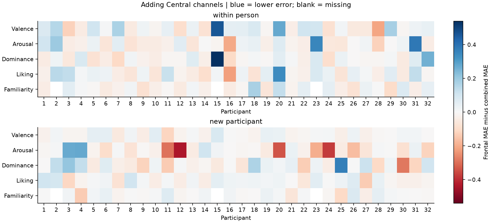

# DEAP의 Central 채널과 개인차

기존 검증에서 사용한 실제 EEG 특징으로 Ridge를 학습했다. 동일한 시행과 폴드에서 전극 구성과 파워 표현만 바꿨다. Frontal은 F3/F4, Central은 C3/C4, 결합은 이 네 전극이다. 표준 라벨은 32명×40편, Familiarity는 s02·s15·s23을 제외한 29명×40편이다.

**개인 내 미관측 영상.** Central 추가 후 평균 MAE가 감소한 라벨은 Arousal, Dominance, Liking, Valence였다. 가장 큰 감소는 Valence의 0.036점이었고 19/32명에서 개선됐다. 해당 감소량의 참가자 재표집 구간은 [-0.005, +0.081]였다.

**미관측 참가자.** Central 추가 후 평균 MAE가 감소한 라벨은 Dominance, Liking였다. 가장 큰 감소는 Dominance의 0.008점이었고 17/32명에서 개선됐다. 해당 감소량의 참가자 재표집 구간은 [-0.033, +0.050]였다.

두 평가 모두 추가 효과의 95% 구간 전체가 양수인 라벨은 없었다. 새 참가자 Arousal은 오히려 오차가 커졌으며, 개인 내 Dominance도 평균은 개선됐지만 개선 인원은 13/32명이었다. 작은 평균 이득을 공통된 생리 반응으로 해석하기 어렵다.

## 개인 내 미관측 영상

각 칸은 전체 보류 예측의 MAE / R²다. 아래 효과는 같은 참가자의 MAE를 짝지어 비교했다.

|라벨|중앙값|Frontal|Central|결합|32채널|
|---|---:|---:|---:|---:|---:|
|Valence|1.810 / -0.060|1.727 / 0.000|1.682 / 0.063|1.691 / 0.038|1.635 / 0.075|
|Arousal|1.589 / -0.011|1.620 / 0.000|1.608 / 0.032|1.607 / 0.020|1.623 / 0.008|
|Dominance|1.572 / 0.079|1.523 / 0.155|1.525 / 0.156|1.508 / 0.161|1.517 / 0.148|
|Liking|1.832 / -0.078|1.897 / -0.038|1.865 / -0.023|1.883 / -0.027|1.870 / -0.051|
|Familiarity|1.228 / -0.193|1.324 / -0.010|1.312 / -0.003|1.326 / -0.028|1.348 / -0.065|

양수는 Central 단독 또는 Central 추가 후의 오차 감소다. 괄호는 개선 인원이다. 구간은 참가자 단위 10,000회 재표집한 평균 개선량의 95% 백분위 구간이다.

|라벨|Frontal − Central MAE|Frontal − 결합 MAE|추가 효과 구간|
|---|---:|---:|---:|
|Valence|+0.045 (18/32)|+0.036 (19/32)|[-0.005, +0.081]|
|Arousal|+0.011 (17/32)|+0.012 (13/32)|[-0.025, +0.055]|
|Dominance|-0.003 (17/32)|+0.015 (13/32)|[-0.018, +0.061]|
|Liking|+0.032 (20/32)|+0.014 (17/32)|[-0.017, +0.048]|
|Familiarity|+0.012 (19/29)|-0.002 (12/29)|[-0.023, +0.022]|

## 미관측 참가자

각 칸은 전체 보류 예측의 MAE / R²다. 아래 효과는 같은 참가자의 MAE를 짝지어 비교했다.

|라벨|중앙값|Frontal|Central|결합|32채널|
|---|---:|---:|---:|---:|---:|
|Valence|1.789 / -0.011|1.818 / -0.023|1.816 / -0.026|1.818 / -0.026|1.821 / -0.033|
|Arousal|1.735 / -0.082|1.717 / -0.054|1.741 / -0.079|1.771 / -0.125|1.706 / -0.046|
|Dominance|1.757 / -0.023|1.751 / -0.016|1.750 / -0.009|1.744 / -0.001|1.763 / -0.055|
|Liking|1.828 / -0.058|1.916 / -0.024|1.916 / -0.021|1.913 / -0.015|1.905 / -0.012|
|Familiarity|1.313 / -0.049|1.419 / -0.042|1.413 / -0.050|1.421 / -0.061|1.437 / -0.089|

양수는 Central 단독 또는 Central 추가 후의 오차 감소다. 괄호는 개선 인원이다. 구간은 참가자 단위 10,000회 재표집한 평균 개선량의 95% 백분위 구간이다.

|라벨|Frontal − Central MAE|Frontal − 결합 MAE|추가 효과 구간|
|---|---:|---:|---:|
|Valence|+0.002 (17/32)|-0.000 (15/32)|[-0.012, +0.013]|
|Arousal|-0.023 (13/32)|-0.054 (10/32)|[-0.107, -0.004]|
|Dominance|+0.002 (14/32)|+0.008 (17/32)|[-0.033, +0.050]|
|Liking|+0.000 (18/32)|+0.004 (19/32)|[-0.015, +0.022]|
|Familiarity|+0.007 (18/29)|-0.001 (16/29)|[-0.018, +0.013]|

## 절대 파워와 기준선 변화량

같은 2초 Welch 창에서 얻은 자극 구간 파워(dB)와 자극−3초 기준선(dB)을 각각 단독 입력하거나 함께 입력했다. 값은 MAE / R²다.

|평가|라벨|전극|절대 파워|기준선 변화량|두 표현 결합|
|---|---|---|---:|---:|---:|
|개인 내 미관측 영상|Valence|Frontal|1.719 / 0.007|1.808 / -0.057|1.727 / 0.000|
|개인 내 미관측 영상|Valence|Central|1.665 / 0.082|1.762 / -0.004|1.682 / 0.063|
|개인 내 미관측 영상|Valence|Combined|1.675 / 0.049|1.783 / -0.027|1.691 / 0.038|
|개인 내 미관측 영상|Valence|Full|1.631 / 0.081|1.743 / -0.015|1.635 / 0.075|
|개인 내 미관측 영상|Dominance|Frontal|1.546 / 0.141|1.561 / 0.114|1.523 / 0.155|
|개인 내 미관측 영상|Dominance|Central|1.536 / 0.166|1.541 / 0.147|1.525 / 0.156|
|개인 내 미관측 영상|Dominance|Combined|1.520 / 0.180|1.536 / 0.130|1.508 / 0.161|
|개인 내 미관측 영상|Dominance|Full|1.540 / 0.152|1.552 / 0.104|1.517 / 0.148|
|미관측 참가자|Valence|Frontal|1.814 / -0.018|1.813 / -0.021|1.818 / -0.023|
|미관측 참가자|Valence|Central|1.811 / -0.019|1.812 / -0.027|1.816 / -0.026|
|미관측 참가자|Valence|Combined|1.822 / -0.026|1.814 / -0.027|1.818 / -0.026|
|미관측 참가자|Valence|Full|1.814 / -0.012|1.822 / -0.039|1.821 / -0.033|
|미관측 참가자|Dominance|Frontal|1.743 / -0.019|1.741 / -0.003|1.751 / -0.016|
|미관측 참가자|Dominance|Central|1.718 / 0.014|1.752 / -0.011|1.750 / -0.009|
|미관측 참가자|Dominance|Combined|1.726 / 0.009|1.745 / -0.003|1.744 / -0.001|
|미관측 참가자|Dominance|Full|1.763 / -0.055|1.747 / -0.005|1.763 / -0.055|

## 채널·대역·시간 구간과 개인차

개인별 외부 학습 폴드에서 선택된 16개 특징의 표준화 Ridge 계수를 사용했다. 각 폴드에서 절댓값 합을 100%로 두고, 미선택 특징에 0을 부여한 뒤 5개 폴드와 32명을 동일 가중 평균했다. 아래 비중은 모델이 사용한 가중치의 분포다. 방향 일치도는 같은 세부 특징이 5개 중 3개 이상 폴드에서 선택된 사람의 평균 계수 부호로 집계했다.

- **Valence**. 32채널 모델에서 비중이 큰 채널은 FC1 5.5%, FC2 4.8%, 대역은 gamma 40.3%, beta 24.8%, 구간은 40-60 40.7%, 0-20 31.3%였다.
  - Central에서 C3/C4의 합산 비중은 100.0%였다. 가장 큰 대역·시간 조합은 gamma 40-60초였다. 개별 특징 중 C3 gamma 40-60초 absolute의 비중이 가장 컸고, 3개 이상 폴드에서 반복 선택된 사람 중 양의 계수 9명, 음의 계수 6명이었다.
  - Combined에서 C3/C4의 합산 비중은 51.4%였다. 가장 큰 대역·시간 조합은 gamma 40-60초였다. 개별 특징 중 C3 gamma 40-60초 absolute의 비중이 가장 컸고, 3개 이상 폴드에서 반복 선택된 사람 중 양의 계수 8명, 음의 계수 4명이었다.
- **Dominance**. 32채널 모델에서 비중이 큰 채널은 Fp1 5.6%, T8 4.8%, 대역은 gamma 34.4%, beta 27.5%, 구간은 40-60 40.5%, 0-20 32.2%였다.
  - Central에서 C3/C4의 합산 비중은 100.0%였다. 가장 큰 대역·시간 조합은 gamma 40-60초였다. 개별 특징 중 C4 theta 40-60초 absolute의 비중이 가장 컸고, 3개 이상 폴드에서 반복 선택된 사람 중 양의 계수 8명, 음의 계수 3명이었다.
  - Combined에서 C3/C4의 합산 비중은 51.2%였다. 가장 큰 대역·시간 조합은 gamma 40-60초였다. 개별 특징 중 C3 gamma 40-60초 absolute의 비중이 가장 컸고, 3개 이상 폴드에서 반복 선택된 사람 중 양의 계수 3명, 음의 계수 3명이었다.

### 실제 신호와 평정의 개인 내 연관성

C3/C4의 평균 dB 특징과 각 평정 사이의 Spearman ρ를 사람마다 40편에서 계산했다. 절대·변화 × 4대역 × 3구간의 24개 조합 중 참가자 ρ 중앙값의 절댓값이 가장 큰 예를 표시한다. 전체 조합은 central_associations.csv에 있다. 이 사후 기술통계는 예측 모델에 반영하지 않았다.

- Valence는 alpha 40-60초 absolute에서 중앙값 ρ가 +0.171였다. 개인별 중간 50% 범위는 [-0.015, +0.258]이고 양의 연관은 23명, 음의 연관은 9명이었다.
- Dominance는 beta 20-40초 absolute에서 중앙값 ρ가 +0.101였다. 개인별 중간 50% 범위는 [-0.050, +0.203]이고 양의 연관은 21명, 음의 연관은 10명이었다.

## 해석 범위와 재현

- 동일인의 미관측 영상은 개인별 외부 5분할, 미관측 참가자는 참가자 단위 외부 4분할이다. 내부 3분할에서도 같은 분리 단위를 유지했다. 각 내부 학습 폴드에서 표준화와 F 통계량 상위 16개 선택을 수행하고 Ridge α 10·100 중 검증 MAE로 선택했다. 위 특징 순위와 외부 결과를 재학습의 특징 선정에 사용하지 않았다.
- 특정 참가자의 향상과 전체 평균의 향상은 서로 다른 결과다. 참가자 재표집 구간은 고정된 보류 예측의 기술적 불확실성으로, 새 학습 집단에서의 재훈련 변동이나 여러 라벨 비교에 대한 보정을 포함하지 않는다. 참가자 외 평가에서는 다른 참가자가 같은 영상을 본 기록이 학습에 들어간다.
- 가중치와 예측 성능은 인과관계를 의미하지 않는다. 상관된 전극·시간 구간·파워 표현 사이에서 가중치가 나뉘거나 특징이 서로 대체될 수 있다. 비중은 뇌 활성량이나 신호 증가 방향을 나타내지 않는다. 전극 추가 비교에는 선택되는 16개 특징과 튜닝 결과의 변화도 포함된다.
- 실제 4채널 장비의 전극 위치와 참조 방식은 DEAP F3/F4/C3/C4와 다를 수 있다. 음악 영상의 시각·청각 효과도 분리되지 않는다. 장비 간 전이나 시각 자극의 독립 효과는 이 결과로 검증되지 않았다.
- BrainFicial 폴더에서 기존 분석용 Python으로 `interpret_eeg.py`, `summarize_eeg.py` 순서로 실행한다. metrics.csv와 participant_metrics.csv는 모든 조건의 MAE·R², participant_differences.csv는 개인별 대응 차이, fold_weights.csv는 선택된 학습 폴드별 계수다.
